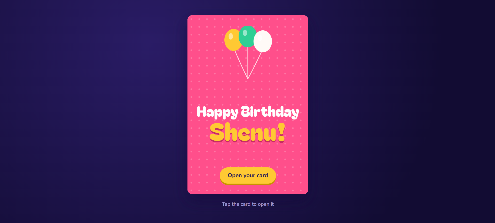

<div align="center">

</div>

# Shenu's Birthday Card 🎂

A single-file interactive birthday card built with plain HTML, CSS and a little vanilla JavaScript. No build step, no dependencies, no framework.

## What it does

- A pink cover card with balloons and a big "Happy Birthday Shenu!" title.
- Tap the card (or the **Open your card** button) and the cover swings open in 3D with a confetti burst.
- Inside: a cake with a flickering candle and a short message.
- **Blow out the candle** snuffs the flame and fires a bigger confetti pop. The button then turns into **Light it again**, so the wish can be repeated.
- Works on phones and desktops, and follows the device's light or dark mode.

## Quick start

1. Save `shenu-birthday-card.html` anywhere.
2. Double-click it to open in any modern browser.

That's it. To share it, host the file anywhere that serves static HTML (GitHub Pages, Netlify, Vercel, etc.) and send the link.

> The page loads two fonts (Bagel Fat One and Nunito) from Google Fonts. Offline, it falls back to system fonts and still works.

## Customizing

Everything lives in `shenu-birthday-card.html`.

| What to change | Where |
| --- | --- |
| Friend's name | Cover `<h1>` (`<span>Shenu!</span>`), the inside `<h2>`, and the page `<title>` |
| Message | The first `<p>` inside `<section class="inside">` |
| Signature | `<p class="sign">From Disandu</p>` |
| Colors | CSS variables at the top of the `<style>` block (`--pink`, `--sun`, `--mint`, `--paper`, `--ink`) |
| Dark mode backdrop | `--bg1`, `--bg2`, `--hint` inside the `prefers-color-scheme: dark` block |
| Confetti colors | The `colors` array in the script |
| Confetti amount | The numbers passed to `burst()` (70 on open, 140 on candle) |

## How it's built

- **Card flip:** the cover is absolutely positioned over the inside page and rotates on the Y axis around its left edge (`transform-origin: left center`). `backface-visibility: hidden` makes it disappear cleanly once it swings past 90°, so it works on narrow screens without overflowing.
- **Candle:** the cake is inline SVG. Toggling an `out` class on the SVG hides the flame, shows a wisp of smoke and flips the button label.
- **Confetti:** a small particle system on a full-screen `<canvas>` using `requestAnimationFrame`. It stops drawing when all particles are gone.

## Accessibility

- Both actions are real `<button>` elements with visible keyboard focus.
- The cake SVG has an accessible label.
- `prefers-reduced-motion` is respected: the flip transition, flame flicker and confetti are turned off.
- Text and background colors keep solid contrast in both light and dark mode.

## Browser support

Any current version of Chrome, Edge, Safari or Firefox.

## Project structure

```
.
├── index.html   # the whole card (HTML + CSS + JS)
└── README.md
```

## License

Free to use, remix and send to your own friends. Happy birthday! 🎉
